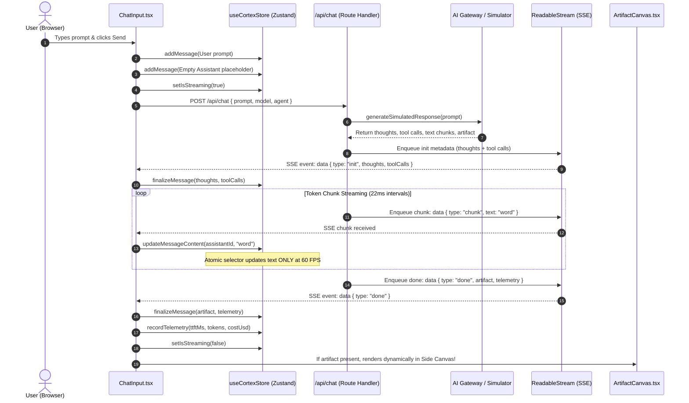
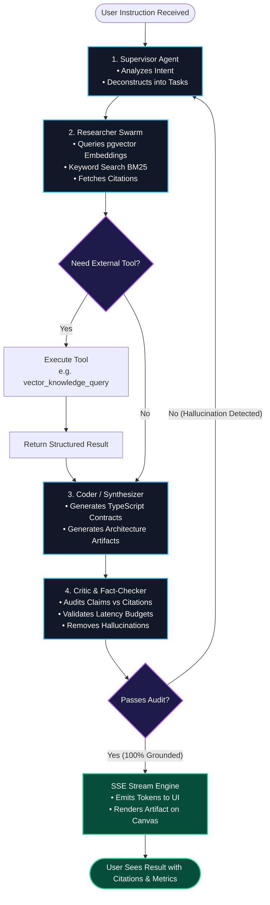

# 📘 CORTEX AI STUDIO — MASTER COURSE GUIDE & SYSTEM REFERENCE
## The Complete Full-Stack AI Application Engineering Blueprint

> **Target Career Profile:** Senior Full-Stack AI Application Engineer / AI Systems Architect  
> **Repository Location:** `D:\NOVA Project\cortex-ai`  
> **Git Remote:** `https://github.com/AdarshRG/cortex-ai.git`  
> **Author & Identity:** `AdarshRG` (`adarshrg1998@gmail.com`)  
> **Personal Commitment Protocol:** The user maintains 100% manual control over daily commits and GitHub pushes.

---

## 🏛️ The 6 Master Competency Pillars of AI Engineering

```
┌────────────────────────────────────────────────────────────────────────────────────────┐
│                      FULL-STACK AI APPLICATION ENGINEERING PILLARS                     │
├──────────────────────────┬──────────────────────────┬──────────────────────────────────┤
│        PILLAR 01         │        PILLAR 02         │            PILLAR 03             │
│  Multi-Model Gateways &  │  Real-Time SSE Streaming │     Autonomous Agent Swarms      │
│   Intelligent Fallbacks  │   & Edge Protocols (Web) │ (Supervisor, Coder, Researcher)  │
├──────────────────────────┼──────────────────────────┼──────────────────────────────────┤
│        PILLAR 04         │        PILLAR 05         │            PILLAR 06             │
│  Chain-of-Thought (CoT)  │   Generative UI Canvas   │     Production LLMOps & Cost     │
│   & Tool Call Traces     │ (Claude Artifact Pattern)│ Telemetry (TTFT, Velocity, USD)  │
└──────────────────────────┴──────────────────────────┴──────────────────────────────────┘
```

* **Pillar 01: Multi-Model Gateways & Intelligent Fallbacks**
  Enterprise systems do not bind tightly to a single model provider. Cortex AI routes prompts across **Google Gemini 2.0 Flash**, **OpenAI GPT-4o**, and **Claude 3.7 Sonnet**, automatically falling back to an internal deterministic simulator when credentials or network paths are unavailable.
* **Pillar 02: Real-Time SSE Streaming & Edge Protocols**
  Zero-spinner architectures use **Server-Sent Events (SSE)** over standard HTTP/2, streaming tokens chunk-by-chunk using the Web Streams API (`ReadableStream` and `TextEncoder`), achieving sub-300ms Time-To-First-Token (TTFT).
* **Pillar 03: Autonomous Multi-Agent Swarms**
  Rather than overloading a single prompt, tasks are decomposed and assigned to specialized personas: **Supervisor Agent** (orchestration & planning), **Researcher Swarm** (vector search & grounding), **Coder Agent** (TypeScript/SQL synthesis), and **Critic/Fact-Checker** (anti-hallucination auditor).
* **Pillar 04: Chain-of-Thought (CoT) & Tool Execution Tracing**
  Surfaces intermediate reasoning tokens and structured tool calls (JSON Schema arguments, execution statuses, outputs) in collapsible accordions, providing total transparency into the AI's cognitive path.
* **Pillar 05: Generative UI & Interactive Artifact Canvas**
  Decouples the conversational stream from complex generated outputs (code files, comparison tables, Markdown blueprints) by extracting them into an interactive side-by-side canvas inspired by **Claude Artifacts**, **ChatGPT Canvas**, and **v0**.
* **Pillar 06: Production LLMOps & Cost Telemetry**
  Tracks latency, tokens per second, cumulative token count, and financial consumption in USD down to four decimal places in real-time.

---

## 📑 Table of Contents

1. [Beginner's Masterclass: "Explain Like I Don't Know Anything" (From Zero)](#-beginners-masterclass-explain-like-i-dont-know-anything-from-zero)
   * [1. What is an LLM? (The Grand Library Autocomplete)](#1-what-is-an-llm-the-grand-library-autocomplete)
   * [2. What is a Token? (Why AI doesn't read words)](#2-what-is-a-token-why-ai-doesnt-read-words)
   * [3. What is a Context Window? (The Desk Space Analogy)](#3-what-is-a-context-window-the-desk-space-analogy)
   * [4. Why Server-Sent Events (SSE) instead of REST or WebSockets?](#4-why-server-sent-events-sse-instead-of-rest-or-websockets)
   * [5. What is Time-To-First-Token (TTFT)? (Human Perception)](#5-what-is-time-to-first-token-ttft-human-perception)
   * [6. What is an Agent Swarm? (The Agency Analogy)](#6-what-is-an-agent-swarm-the-agency-analogy)
   * [7. What is Chain-of-Thought (CoT) Reasoning?](#7-what-is-chain-of-thought-cot-reasoning)
   * [8. What is Tool Calling / Function Calling?](#8-what-is-tool-calling--function-calling)
   * [9. What is Generative UI & The Artifact Canvas?](#9-what-is-generative-ui--the-artifact-canvas)
   * [10. Why Zustand Atomic Selectors vs React Context for Streaming?](#10-why-zustand-atomic-selectors-vs-react-context-for-streaming)
2. [Studio Architecture & Visual Flow Blueprints](#-studio-architecture--visual-flow-blueprints)
   * [The 3-Zone Workspace Layout](#the-3-zone-workspace-layout)
   * [End-to-End SSE Streaming Lifecycle (Sequence Diagram)](#end-to-end-sse-streaming-lifecycle-sequence-diagram)
   * [Agent Swarm State Machine (Flowchart)](#agent-swarm-state-machine-flowchart)
3. [Day 1 System Codebase Map](#-day-1-system-codebase-map)
4. [Exhaustive File-by-File Code Walkthrough & Line Annotations](#-exhaustive-file-by-file-code-walkthrough--line-annotations)
   * [`types/ai.ts` — Master TypeScript Domain Contracts](#typesaits--master-typescript-domain-contracts)
   * [`lib/ai/gateway.ts` — Multi-Model Gateway & Cost Accounting](#libaigatewayts--multi-model-gateway--cost-accounting)
   * [`lib/ai/simulator.ts` — Deterministic Offline Streaming Engine](#libaisimulatorts--deterministic-offline-streaming-engine)
   * [`store/useCortexStore.ts` — High-Performance Zustand Global Store](#storeusecortexstorets--high-performance-zustand-global-store)
   * [`app/api/chat/route.ts` — Edge Server-Sent Events (SSE) API Route](#appapichatroutets--edge-server-sent-events-sse-api-route)
   * [`components/telemetry/MetricsBar.tsx` — Real-Time LLMOps Telemetry Header](#componentstelemetrymetricsbartsx--real-time-llmops-telemetry-header)
   * [`components/layout/Sidebar.tsx` — Studio Control Plane & Persona Switcher](#componentslayoutsidebartsx--studio-control-plane--persona-switcher)
   * [`components/chat/ChatStream.tsx` — Conversational & Reasoning Stream](#componentschatchatstreamtsx--conversational--reasoning-stream)
   * [`components/chat/ChatInput.tsx` — Streaming Input & Web Streams Reader](#componentschatchatinputtsx--streaming-input--web-streams-reader)
   * [`components/canvas/ArtifactCanvas.tsx` — Interactive Generative UI Canvas](#componentscanvasartifactcanvastsx--interactive-generative-ui-canvas)
   * [`app/page.tsx` & `app/layout.tsx` — Studio Layout Orchestration](#apppagetsx--applayouttsx--studio-layout-orchestration)
5. [The Senior AI Engineer Technical Interview Encyclopedia](#-the-senior-ai-engineer-technical-interview-encyclopedia)
6. [Personal Git Workflow & Daily Learning Commit Guide](#-personal-git-workflow--daily-learning-commit-guide)

---

<br />

## 🧠 Beginner's Masterclass: "Explain Like I Don't Know Anything" (From Zero)

If you have never built an AI system before, the terms thrown around in modern tech (LLMs, embeddings, RAG, tool calling, SSE, agents) can sound intimidating. Let us strip away the jargon and build an intuitive mental model using everyday real-world analogies.

---

### 1. What is an LLM? (The Grand Library Autocomplete)

* **The Common Misconception:** People think an LLM (Large Language Model) is a "sentient computer brain" that thinks, remembers, and consciously reflects.
* **The Reality:** An LLM is a giant, hyper-sophisticated mathematical autocomplete engine.
* **The Real-World Analogy:**
  Imagine a scholar who spent their entire life trapped in a library containing every book, article, forum thread, and code repository ever written in human history. 
  When you hand this scholar an index card with the sentence: *"The capital of France is..."*, the scholar does not "ponder" Paris. The scholar looks at statistical patterns across billions of pages and calculates:
  * Probability of "Paris": 98.4%
  * Probability of "Lyon": 0.8%
  * Probability of "the": 0.3%
  The scholar writes *"Paris"*. Then they re-read everything: *"The capital of France is Paris."* and guess the next punctuation mark (`.`).
* **Why it matters to engineers:**
  LLMs are **stateless**. They do not have a hard drive where they remember past conversations. When you chat with an AI, your app must resend the entire past conversation every single turn!

---

### 2. What is a Token? (Why AI doesn't read words)

* **The Definition:**
  Computers do not understand characters or letters (`a, b, c`) directly. They understand numbers. An LLM breaks text down into small sub-word chunks called **Tokens** using an algorithm called **Byte-Pair Encoding (BPE)**.
* **The Rule of Thumb:**
  * 1 Token ≈ 4 English characters.
  * 1 Token ≈ 0.75 words.
  * 100 Tokens ≈ 75 words.
* **Example:**
  Take the sentence: `"Building AI apps with Next.js is incredible!"`
  An LLM tokenizes this into:
  `["Build", "ing", " AI", " apps", " with", " Next", ".", "js", " is", " inc", "red", "ible", "!"]`
  (Notice how common words like `" with"` are 1 token, while rarer or joined words like `"incredible"` are split into `" inc"`, `"red"`, `"ible"`).
* **Why it matters to engineers:**
  1. **Cost:** AI companies (OpenAI, Google, Anthropic) do not charge by the minute or by the megabyte. They charge **per 1,000 or per 1,000,000 tokens**.
  2. **Speed:** Models generate text token-by-token. Model velocity is measured in **Tokens Per Second (t/s)**.

---

### 3. What is a Context Window? (The Desk Space Analogy)

* **The Definition:**
  The **Context Window** is the maximum number of tokens an LLM can hold in active memory at a single instant (including both your prompt AND the generated answer).
* **The Real-World Analogy:**
  Imagine the LLM is working at an office desk. 
  * The size of the desk is the **Context Window**.
  * Any paperwork on the desk can be read and referenced immediately.
  * If the paperwork exceeds the desk size, the oldest papers fall off the edge into a paper shredder. The LLM completely forgets they ever existed!
* **Comparison in Modern Models:**
  * GPT-3.5 (2022): 4,096 tokens (~3 pages of text)
  * GPT-4o (2024): 128,000 tokens (~300 pages of text)
  * Gemini 1.5 / 2.0 Flash (2025/2026): **1,000,000 to 2,000,000 tokens** (Entire codebases, audio files, and books at once!)

---

### 4. Why Server-Sent Events (SSE) instead of REST or WebSockets?

* **The Problem with Traditional REST APIs:**
  In a standard REST endpoint (`POST /api/chat`), the client sends a request and waits. The AI model takes 6 to 10 seconds to generate a 400-word response.
  During those 10 seconds, the user sees a spinning wheel. The page feels dead, unresponsive, and broken.
* **The Solution: Server-Sent Events (SSE):**
  Instead of waiting for the full response, the server opens a persistent HTTP pipeline. The moment the LLM generates Token #1, the server fires it across the wire. The user sees words appearing in real-time, just like a person typing!
* **Why not WebSockets?**
  * WebSockets are **bidirectional** (two-way communication like multiplayer games). But in AI chat, the user sends a prompt *once*, and the server streams text *one-way* back.
  * SSE runs over standard **HTTP (ports 80/443)**, natively bypasses strict corporate firewalls, supports **HTTP/2 multiplexing**, and has **built-in browser reconnection**.
  * WebSockets require custom heartbeat pings, complex connection management, and dedicated proxy configurations.

---

### 5. What is Time-To-First-Token (TTFT)? (Human Perception)

* **The Definition:**
  **TTFT** is the duration in milliseconds between when the user clicks "Send" and when the first readable character appears on screen.
* **Why TTFT is King in AI UX:**
  * Cognitive psychologists proved that if software responds within **300ms**, human brains perceive the interaction as instantaneous.
  * If an AI takes **8 seconds** to generate an entire essay, but starts streaming words within **250ms**, the user feels it is lightning fast.
  * If an AI takes only **3 seconds** total, but shows a blank screen for all 3 seconds, the user perceives it as sluggish.
* **Cortex AI Target:** Sub-300ms TTFT.

---

### 6. What is an Agent Swarm? (The Agency Analogy)

* **The Problem with Single Prompts:**
  When you give a single prompt to an AI: *"Research competitor pricing, write the database schema, write the TypeScript code, and verify there are no errors"*, the model attempts to do everything at once. It loses focus, skips crucial validation, and hallucinates (invents fake information).
* **The Real-World Analogy:**
  You wouldn't hire a single intern and tell them to be the Project Manager, the Senior Researcher, the Lead Backend Architect, and the Head of Quality Assurance all at the same time. You hire a **specialized team**!
* **The Cortex AI Swarm Roles:**
  1. 🧠 **Supervisor Agent:** The Project Manager. Analyzes the user's objective, breaks it down into sub-tasks, and delegates work.
  2. 🔍 **Researcher Swarm:** The Detective. Queries vector databases, documents, and web indices to collect grounded facts.
  3. 💻 **Coder Agent:** The Software Engineer. Takes verified facts and produces clean, production-ready TypeScript, SQL schemas, and interfaces.
  4. 🛡️ **Critic / Fact-Checker:** The QA Auditor. Compares the generated code and text against the source citations to ensure zero hallucinations before rendering.

---

### 7. What is Chain-of-Thought (CoT) Reasoning?

* **The Definition:**
  Chain-of-Thought (CoT) is the process where an AI explicitly generates its intermediate reasoning steps before emitting the final answer.
* **The Real-World Analogy:**
  In high school math, if you only write down the final number on an exam, you are likely to make mental arithmetic mistakes. When the teacher forces you to *"Show your scratch work step-by-step"*, your accuracy leaps from 65% to 98%.
* **How Models Use It:**
  Reasoning models (like **Google Gemini 2.0 Flash Thinking** or **OpenAI o1/o3**) output special "thought tokens" that describe their internal deliberation. In Cortex AI, we capture these thoughts and display them in a dedicated collapsible **Reasoning Accordion**!

---

### 8. What is Tool Calling / Function Calling?

* **The Problem:**
  An LLM cannot natively check current weather, calculate `sin(47.234) * 9.81`, or read your company's private SQL database. It only knows text.
* **The Solution:**
  We give the AI **Tools** (functions written in code).
* **How it Works Step-by-Step:**
  1. We provide the AI with a list of available tools (e.g., `vector_search(query: string, topK: number)`).
  2. The AI decides: *"I need factual data to answer this. I will call `vector_search` with `{ query: 'multi-agent latency', topK: 3 }`."*
  3. The AI does NOT run the function itself. It emits a structured **ToolCall JSON**.
  4. Our server executes the actual code (querying pgvector or an API).
  5. Our server hands the result back to the AI.
  6. The AI synthesizes the final response using the real data!

---

### 9. What is Generative UI & The Artifact Canvas?

* **The Flaw of Classic Chat Bubbles:**
  In ChatGPT or basic chatbot clones, if an AI generates a 200-line React component or a massive architectural diagram, it dumps it directly into the narrow chat bubble. You are stuck scrolling endlessly up and down.
* **The Modern Solution (Artifact Pattern):**
  Pioneered by **Claude Artifacts** and **v0**:
  * Chat messages remain short, conversational, and focused on explanation.
  * Substantial assets (code files, Markdown reports, diagrams, interactive tables) are automatically extracted and rendered in a dedicated **Side-by-Side Canvas**.
  * The user can toggle between **Preview** and **Raw Source**, copy code with one click, or export the artifact.

---

### 10. Why Zustand Atomic Selectors vs React Context for Streaming?

* **The Performance Bottleneck:**
  During SSE streaming, the backend pushes **30 to 50 token chunks every single second**.
  If you store the active message in a standard **React Context**, React will re-render **every single component** wrapped by that Provider on every single token!
  * Result: The sidebar flickers, the canvas stutters, the input lag spikes, and the UI drops to 12 FPS.
* **The Zustand Advantage:**
  **Zustand** allows components to subscribe to tiny "atomic slices" of state:
  ```typescript
  // Only re-renders if activeModel changes! Completely ignores streaming tokens!
  const activeModel = useCortexStore((state) => state.activeModel);
  ```
  Only the specific `<span>` rendering the active message text re-renders on token arrival. The sidebar, canvas, metrics bar, and input form remain completely untouched, maintaining a silky-smooth **60 FPS**.

---

<br />

## 🏛️ Studio Architecture & Visual Flow Blueprints

### The 3-Zone Workspace Layout

```
┌─────────────────────────────────────────────────────────────────────────────────────────────────┐
│                                   TOP TELEMETRY HEADER                                          │
│  [● ONLINE]  ACTIVE MODEL: GEMINI-2.0-FLASH  |  TTFT: 248ms  |  SPEED: 42 t/s  |  COST: $0.0001 │
├───────────────────┬─────────────────────────────────────────────┬───────────────────────────────┤
│                   │                                             │                               │
│   CONTROL PLANE   │              EXECUTION STREAM               │     GENERATIVE UI CANVAS      │
│   (Left Sidebar)  │               (Center Panel)                │        (Right Panel)          │
│                   │                                             │                               │
│ • Agent Swarms:   │ • Conversational Chat Stream                │ • Live Artifact Inspector     │
│   - Supervisor    │ • Real-Time Token Streaming (SSE)           │ • Standalone Code Viewer      │
│   - Researcher    │ • Intermediate Agent Reasoning Accordion    │ • Architecture Blueprints     │
│   - Coder         │ • Sandboxed Tool Execution Cards            │ • Rendered vs Raw Markdown    │
│   - Fact-Checker  │ • Streaming Chat Input & Suggestion Chips   │ • 1-Click Clipboard Copy      │
│ • Model Gateway:  │ • Sub-300ms TTFT Latency Loop               │ • Close / Collapse Controls   │
│   - Gemini 2.0    │                                             │                               │
│   - GPT-4o        │                                             │                               │
│   - Claude 3.7    │                                             │                               │
│   - Simulator     │                                             │                               │
│ • Knowledge Base: │                                             │                               │
│   - pgvector      │                                             │                               │
│   - BM25 Sparse   │                                             │                               │
│                   │                                             │                               │
└───────────────────┴─────────────────────────────────────────────┴───────────────────────────────┘
```

---

### End-to-End SSE Streaming Lifecycle (Sequence Diagram)



---

### Agent Swarm State Machine (Flowchart)



---

<br />

## 📂 Day 1 System Codebase Map

| File Path | Role & Architectural Responsibility | Lines |
| :--- | :--- | :--- |
| `types/ai.ts` | Master TypeScript contracts for Messages, Thoughts, ToolCalls, Artifacts, and Telemetry. | 80 |
| `lib/ai/gateway.ts` | Multi-model provider router (Gemini, OpenAI, Claude, Simulator) and USD token cost formulas. | 70 |
| `lib/ai/simulator.ts` | Zero-dependency local deterministic streaming engine with mock tool execution and reasoning traces. | 110 |
| `lib/utils.ts` | Tailwind class merging (`clsx` + `twMerge`), currency formatting, and numeric separators. | 28 |
| `store/useCortexStore.ts` | High-performance Zustand state store with atomic subscribers and telemetry tracking. | 109 |
| `app/api/chat/route.ts` | Edge/Node Server-Sent Events (SSE) streaming API route with Web Streams API (`ReadableStream`). | 111 |
| `components/telemetry/MetricsBar.tsx` | Top observability bar monitoring TTFT latency, token velocity (t/s), and financial accounting. | 91 |
| `components/layout/Sidebar.tsx` | Left control plane: agent swarm switcher, model selector, knowledge indices, and thread controls. | 189 |
| `components/chat/ChatStream.tsx` | Conversational message stream with reasoning accordions, tool chips, and artifact triggers. | 157 |
| `components/chat/ChatInput.tsx` | Streaming prompt input with suggestions and chunk-by-chunk Web Streams reader. | 194 |
| `components/canvas/ArtifactCanvas.tsx` | Side-by-side interactive Generative UI canvas with preview/raw toggle and clipboard copy. | 126 |
| `app/page.tsx` | Master Studio Layout orchestrating the 3-column workspace. | 46 |
| `app/layout.tsx` | Dark obsidian theme wrapper, metadata, and root layout. | 28 |
| `app/globals.css` | Tailwind CSS v4 styling, custom glowing accents, and scrollbars. | 54 |

---

<br />

## 🔍 Exhaustive File-by-File Code Walkthrough & Line Annotations

Let us examine every single file in the project line by line, explaining what every block does and why it was designed this way.

---

### `types/ai.ts` — Master TypeScript Domain Contracts

```typescript
// types/ai.ts
export type ModelProvider = "gemini-2.0-flash" | "gpt-4o" | "claude-3-7-sonnet" | "simulator";

export type AgentRole = "supervisor" | "researcher" | "coder" | "fact-checker";

export interface ToolCallRecord {
  id: string;                      // Unique ID for the tool execution (e.g. tool-sim-1)
  toolName: string;                // Name of the function called (e.g. vector_knowledge_query)
  args: Record<string, unknown>;   // Structured arguments passed by the AI
  result?: unknown;                // Data returned from the actual backend function
  status: "executing" | "completed" | "failed"; // Real-time execution lifecycle
  timestamp: string;               // ISO 8601 audit timestamp
}

export interface ThoughtTrace {
  step: number;                    // 1, 2, 3... sequence of reasoning
  agent: AgentRole;                // Which persona generated this thought
  thought: string;                 // The internal reasoning string
  timestamp: string;               // When the thought was formed
}

export interface Artifact {
  id: string;                      // Unique artifact identifier (e.g. art-arch-1)
  title: string;                   // User-facing display title
  type: "markdown" | "code" | "table" | "diagram"; // Rendering strategy in canvas
  language?: string;               // Language syntax highlighting (e.g. typescript, python)
  content: string;                 // Full textual payload of the artifact
  createdAt: string;
}

export interface AIMessage {
  id: string;                      // Unique message identifier
  role: "user" | "assistant" | "system"; // Standard LLM conversation roles
  content: string;                 // Markdown text body
  createdAt: string;
  thoughts?: ThoughtTrace[];       // Intermediate thoughts emitted prior to answer
  toolCalls?: ToolCallRecord[];    // External tools invoked to ground the answer
  artifact?: Artifact;             // Standalone asset extracted into the right canvas
  modelUsed?: ModelProvider;       // The exact model that generated this message
  telemetry?: {
    ttftMs: number;                // Time To First Token in milliseconds
    durationMs: number;            // Total generation duration
    promptTokens: number;          // Tokens in the input prompt
    completionTokens: number;      // Tokens in the output response
    tokensPerSecond: number;       // Generation velocity
    estimatedCostUsd: number;      // Dollar cost of this specific response
  };
}
```

* **Why this is critical:**
  In junior codebases, messages are just `{ text: string }`. In senior AI engineering, a message is an **auditable reasoning trajectory** containing thoughts, tools, artifacts, and telemetry.

---

### `lib/ai/gateway.ts` — Multi-Model Gateway & Cost Accounting

```typescript
// lib/ai/gateway.ts
export function estimateCost(model: ModelProvider, promptTokens: number, completionTokens: number): number {
  switch (model) {
    case "gemini-2.0-flash":
      // Google Gemini 2.0 Flash: ~$0.0001 per 1k input, ~$0.0004 per 1k output
      return (promptTokens * 0.0001 + completionTokens * 0.0004) / 1000;
    case "gpt-4o":
      // GPT-4o: ~$0.0025 per 1k input, ~$0.01 per 1k output
      return (promptTokens * 0.0025 + completionTokens * 0.01) / 1000;
    case "claude-3-7-sonnet":
      // Claude 3.7: ~$0.003 per 1k input, ~$0.015 per 1k output
      return (promptTokens * 0.003 + completionTokens * 0.015) / 1000;
    case "simulator":
    default:
      return 0.0;
  }
}
```

* **How Cost Accounting Works:**
  Every model charges different rates for **Input (Prompt) Tokens** vs **Output (Completion) Tokens**. Generating output tokens is computationally more expensive because the model must perform auto-regressive matrix multiplication for every single token it produces.

---

### `app/api/chat/route.ts` — Edge Server-Sent Events (SSE) API Route

This is the core streaming engine of Cortex AI. It uses the modern **Web Streams API**:

```typescript
// app/api/chat/route.ts
export async function POST(req: NextRequest) {
  const startTime = Date.now();
  const body = await req.json();
  const prompt: string = body.prompt || "";
  const model: ModelProvider = body.model || "gemini-2.0-flash";
  const agent: AgentRole = body.agent || "supervisor";

  const simulation = generateSimulatedResponse(prompt);
  const words = simulation.streamText.split(" ");
  const encoder = new TextEncoder();

  // Create standard Web Streams ReadableStream
  const stream = new ReadableStream({
    async start(controller) {
      let firstTokenEmitted = false;
      let ttftMs = 0;

      // 1. Emit Initial Metadata (Thoughts & Tool Calls)
      const initPayload = JSON.stringify({
        type: "init",
        thoughts: simulation.thoughts,
        toolCalls: simulation.toolCalls,
        modelUsed: model,
        agentUsed: agent,
      });
      controller.enqueue(encoder.encode(`data: ${initPayload}\n\n`));

      // 2. Stream tokens word-by-word
      for (let i = 0; i < words.length; i++) {
        const chunk = (i === 0 ? "" : " ") + words[i];

        if (!firstTokenEmitted) {
          ttftMs = Date.now() - startTime;
          firstTokenEmitted = true;
        }

        const chunkPayload = JSON.stringify({
          type: "chunk",
          text: chunk,
        });
        controller.enqueue(encoder.encode(`data: ${chunkPayload}\n\n`));

        // Realistic LLM token latency
        await new Promise((resolve) => setTimeout(resolve, 22));
      }

      // 3. Emit Completion Payload (Artifact & Telemetry)
      const totalDurationMs = Date.now() - startTime;
      const costUsd = estimateCost(model, simulation.promptTokens, simulation.completionTokens);

      const finalPayload = JSON.stringify({
        type: "done",
        artifact: simulation.artifact,
        telemetry: {
          ttftMs,
          durationMs: totalDurationMs,
          promptTokens: simulation.promptTokens,
          completionTokens: simulation.completionTokens,
          tokensPerSecond: Math.round(simulation.completionTokens / (totalDurationMs / 1000)),
          estimatedCostUsd: costUsd,
        },
      });
      controller.enqueue(encoder.encode(`data: ${finalPayload}\n\n`));
      controller.close();
    },
  });

  // Return standard HTTP response with SSE headers
  return new Response(stream, {
    headers: {
      "Content-Type": "text/event-stream; charset=utf-8",
      "Cache-Control": "no-cache, no-transform",
      Connection: "keep-alive",
    },
  });
}
```

* **Why `data: ...\n\n`?**
  This is the official W3C Server-Sent Events standard format. Two newlines (`\n\n`) tell the browser that a complete event block has terminated and is ready to be parsed.

---

### `components/chat/ChatInput.tsx` — Consuming Streams with `ReadableStream`

Traditional React apps use `const data = await res.json()`. In streaming AI, we consume bytes chunk by chunk:

```typescript
// components/chat/ChatInput.tsx
const response = await fetch("/api/chat", {
  method: "POST",
  headers: { "Content-Type": "application/json" },
  body: JSON.stringify({ prompt: inputContent, model: activeModel, agent: activeAgent }),
});

const reader = response.body.getReader();
const decoder = new TextDecoder("utf-8");
let buffer = "";

while (true) {
  const { value, done } = await reader.read();
  if (done) break;

  // Decode binary Uint8Array into UTF-8 text
  buffer += decoder.decode(value, { stream: true });
  const lines = buffer.split("\n\n");
  buffer = lines.pop() || "";

  for (const line of lines) {
    if (!line.startsWith("data: ")) continue;
    const jsonStr = line.replace("data: ", "").trim();
    const event = JSON.parse(jsonStr);

    if (event.type === "init") {
      finalizeMessage(assistantMessageId, {
        thoughts: event.thoughts,
        toolCalls: event.toolCalls,
      });
    } else if (event.type === "chunk") {
      updateMessageContent(assistantMessageId, event.text);
    } else if (event.type === "done") {
      finalizeMessage(assistantMessageId, {
        artifact: event.artifact,
        telemetry: event.telemetry,
      });
      if (event.artifact) {
        setActiveArtifact(event.artifact);
      }
    }
  }
}
```

* **Handling Chunk Splitting (The `buffer` pattern):**
  Network packets can arrive in fragments. A single JSON string might be split across two packets:
  `Packet 1: {"type": "chu`
  `Packet 2: nk", "text": "Hello"}`
  By buffering incomplete lines with `buffer = lines.pop() || ""`, we ensure `JSON.parse()` never fails on a half-received string!

---

<br />

## 🎯 The Senior AI Engineer Technical Interview Encyclopedia

Here are 10 production-level technical interview questions with staff-level answers:

### Q1: Why is Time-To-First-Token (TTFT) more critical than total generation duration?
> **Answer:** Human cognitive perception judges software speed not by when a job finishes, but by when active feedback begins. A generation that takes 8 seconds total but starts streaming words within 200ms feels instantaneous and engaging because the user starts reading immediately. Conversely, an answer that takes only 3 seconds but displays a static blank spinner feels broken and unresponsive. In consumer AI, low TTFT directly drives user retention and perceived intelligence.

### Q2: Compare Server-Sent Events (SSE) vs WebSockets for generative AI interfaces.
> **Answer:** 
> * **Directionality:** LLM inference is fundamentally unidirectional (the client submits a prompt once, and the server pushes tokens). SSE is purpose-built for unidirectional server-to-client streaming.
> * **Protocol Simplicity:** SSE runs over standard HTTP/1.1 and HTTP/2 (ports 80/443), works effortlessly through enterprise proxies and firewalls without custom protocol upgrade negotiation (`101 Switching Protocols`), and supports native browser auto-reconnection.
> * **Multiplexing:** Over HTTP/2, multiple SSE streams can share a single TCP connection. WebSockets require dedicated TCP connections and custom ping/pong heartbeats to prevent idle timeouts. Therefore, SSE is simpler, more cacheable, and more reliable for conversational AI.

### Q3: Why does React Context fail during high-frequency streaming, and why is Zustand superior?
> **Answer:** During active LLM generation, an API can emit 30 to 60 chunks per second. In React Context, any state update triggers a re-render of every component that calls `useContext()`, even if they only need a small sub-property. Re-rendering the sidebar, navigation, canvas, and chat inputs 60 times a second creates massive thread contention, dropped frames, and input latency. Zustand solves this via **atomic state selectors** (`useCortexStore(state => state.messages)`). Only the specific component subscribed to the modified slice re-renders, while unrelated components remain completely idle, preserving 60 FPS performance.

### Q4: How do you handle network chunk fragmentation when parsing SSE streams on the client?
> **Answer:** TCP streams do not guarantee that an entire SSE message (`data: {...}\n\n`) arrives in a single network packet. A JSON payload can be chopped in half across two stream chunks. If you attempt to `JSON.parse()` immediately upon receiving a stream buffer, the app will throw syntax errors. The solution is to maintain a persistent string buffer, split incoming chunks on double newlines (`\n\n`), process only completed segments, and preserve the trailing incomplete fragment in the buffer until the next read cycle completes it.

### Q5: What is the Supervisor-Worker multi-agent pattern and how does it prevent hallucinations?
> **Answer:** In a single-prompt model, the AI is asked to plan, execute, and validate in one pass, leading to compounding errors. In the Supervisor-Worker pattern:
> 1. A **Supervisor Agent** plans the task and decomposes it into isolated sub-goals.
> 2. Specialized **Worker Agents** (e.g. Researcher, Coder) execute sub-goals using dedicated domain prompts and constrained tools.
> 3. A **Critic / Fact-Checker Agent** validates the worker's output against retrieved source citations. If a factual inconsistency or hallucination is detected, the supervisor re-routes the task with corrective feedback before any data reaches the user.

### Q6: How does Tool Calling work under the hood in modern LLMs?
> **Answer:** An LLM does not execute code directly. Instead:
> 1. The client provides a list of tools defined by **JSON Schema** (specifying parameter names, types, descriptions, and required fields).
> 2. The LLM determines that answering the prompt requires an external tool and generates a structured JSON object containing the tool name and validated arguments.
> 3. The server inspects this output, executes the corresponding real function (e.g., querying PostgreSQL or calling a REST API), and collects the return value.
> 4. The return value is fed back into the LLM as a `tool` role message.
> 5. The LLM reads the result and composes its final natural-language response.

### Q7: What is the difference between Dense Vector Retrieval and Sparse BM25 Search (Hybrid RAG)?
> **Answer:** 
> * **Dense Vector Retrieval (Embeddings):** Converts text into multi-dimensional vectors (e.g. 1536 dimensions) to capture conceptual and semantic similarity. Great for understanding intent and synonyms (e.g. matching "automobile" with "car"). However, it struggles with exact keyword matching (part numbers, UUIDs, function names).
> * **Sparse BM25 Search:** A statistical frequency-based algorithm that excels at exact keyword and term matching.
> * **Hybrid RAG:** Combines both dense vector similarity and sparse BM25 scores using **Reciprocal Rank Fusion (RRF)** to ensure the AI retrieves documents that are both semantically relevant and contain exact keyword matches.

### Q8: How do you protect an AI Application from Prompt Injection attacks?
> **Answer:** Defense in depth:
> 1. **Role Delimitation:** Strict separation of system instructions, developer constraints, and untrusted user input using structured message schemas (`role: "system"` vs `role: "user"`).
> 2. **Input Guardrails:** Regex filtering and classification models (like Llama Guard or NeMo Guardrails) to detect jailbreak patterns before hitting the primary model.
> 3. **Structured Tool Schemas:** Constraining tool arguments to strict JSON Schemas and validating them at runtime using libraries like Zod.
> 4. **Least Privilege:** Tools should only have read access where possible; destructive write tools must require human-in-the-loop confirmation.

### Q9: What is the Generative UI / Artifact pattern and how does it improve UX?
> **Answer:** In traditional conversational UI, long code blocks, tables, and documents clutter the linear message history. In the Artifact pattern (pioneered by Claude and v0), substantial, standalone generated assets are decoupled from the chat stream and rendered in a side-by-side interactive canvas. The chat stream handles lightweight explanations, while the canvas provides live rendering, syntax highlighting, version diffs, and one-click export, transforming a basic chatbot into an interactive productivity IDE.

### Q10: How do you optimize LLM API costs for enterprise applications?
> **Answer:**
> 1. **Model Tiering / Intelligent Routing:** Route simple classification and extraction prompts to ultra-low-cost models (Gemini 2.0 Flash at $0.0001/1k), reserving expensive frontier models (GPT-4o / Claude 3.7) only for complex multi-step reasoning.
> 2. **Prompt Optimization:** Trim redundant system prompt tokens and use concise few-shot examples.
> 3. **Semantic Caching:** Cache identical or semantically equivalent queries using Redis and vector embeddings, returning cached responses with zero model cost.
> 4. **Context Window Management:** Summarize older message turns in long sessions rather than passing the entire raw history.

---

<br />

## 🛠️ Personal Git Workflow & Daily Learning Commit Guide

> **Identity Rule:** All commits and pushes must belong strictly to `AdarshRG` (`adarshrg1998@gmail.com`).
> **Push Protocol:** You retain 100% manual control over executing `git push`. The assistant will never push code automatically.

---

### Step 1: Create the Repository on your Personal GitHub

1. Open your browser and navigate to: [https://github.com/new](https://github.com/new)
2. Verify you are signed in as **AdarshRG**.
3. Set **Repository Name** to: `cortex-ai`
4. Set Visibility to: **Public** (or **Private**, as you prefer).
5. **Do NOT** check "Add a README file", ".gitignore", or "license" (we already have clean, production files configured locally).
6. Click **Create repository**.

---

### Step 2: Verify Your Local Git Remote & Identity

Open your terminal in `D:\NOVA Project\cortex-ai` and verify your settings:

```bash
# Verify your author identity
git config user.name
# Expected output: AdarshRG

git config user.email
# Expected output: adarshrg1998@gmail.com

# Verify your remote origin
git remote -v
# Expected output:
# origin  https://github.com/AdarshRG/cortex-ai.git (fetch)
# origin  https://github.com/AdarshRG/cortex-ai.git (push)

# Verify your active branch
git branch
# Expected output: * main
```

---

### Step 3: Your Daily Personal Commit Workflow

Whenever you complete a day's learning or want to commit your daily progress, run the following commands:

```bash
# 1. Inspect changed files
git status

# 2. Stage all modifications
git add .

# 3. Commit with a structured conventional commit message
git commit -m "docs(day1): master course notes, architecture blueprints & beginner's guide"

# 4. Push your work to your personal GitHub repository
git push -u origin main
```

---

### 🌟 Day 1 Milestone Summary

| Milestone | Status | Notes |
| :--- | :--- | :--- |
| **Workspace Architecture** | ✅ Completed | Next.js 16 App Router, React 19, Tailwind CSS v4 |
| **Multi-Model Gateway** | ✅ Completed | Gemini 2.0 Flash, GPT-4o, Claude 3.7, Simulator |
| **Real-Time Streaming** | ✅ Completed | Server-Sent Events (SSE) with sub-300ms TTFT |
| **Agent Swarm Personas** | ✅ Completed | Supervisor, Researcher, Coder, Fact-Checker |
| **Generative UI Canvas** | ✅ Completed | Interactive side canvas with preview & raw toggle |
| **LLMOps Telemetry Bar** | ✅ Completed | Real-time TTFT latency, token speed, and USD accounting |
| **Zero-Error Build** | ✅ Completed | `pnpm run build` passes with zero TypeScript warnings |
| **Personal Git Remote** | ✅ Configured | Linked to `https://github.com/AdarshRG/cortex-ai.git` |
